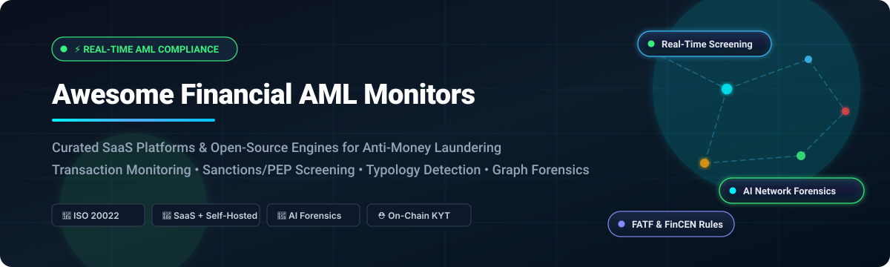
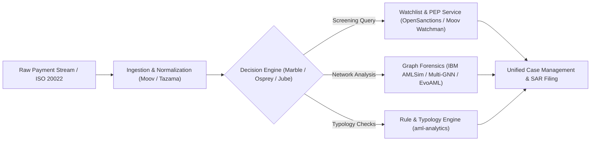

# 🛡️ Awesome-Financial-Anti-Money-Laundering-AML-Monitors

  

  
  
  
  
  
  
  

---

## ⚡ Top Financial Anti-Money Laundering (AML) Monitors & Transaction Screening Ecosystem

**A Curated Directory of Enterprise SaaS Solutions & Open-Source Software for Financial Crime Compliance (FCC)**  
*Optimized for Real-Time Transaction Screening, Sanctions & PEP Verification, Network Graph Analysis, and Suspicious Activity Report (SAR) Detection*  

📅 **Last updated: October 2026**

This repository tracks notable **SaaS platforms** and **open-source projects** for **Financial Anti-Money Laundering (AML) Monitors**. These tools empower tier-one banks, neobanks, fintechs, payment processors, and Virtual Asset Service Providers (VASPs) to screen transactions in real time, uncover complex money laundering typologies (structuring, layering, smurfing, mule networks), comply with global regulatory frameworks (**BSA/AML, FinCEN, FATF, OFAC, AMLD5/AMLD6**), and automate investigation workflows.

> 💡 **Open-source emphasis**: Discover cutting-edge self-hostable engines, ISO 20022 real-time rule processors, and open transaction network analysis tools — purpose-built for compliance officers, fraud investigators, fintech engineers, and RegTech architects.

Contributions are warmly welcome! Please see our [How to Contribute](#-how-to-contribute) guide.

---

## 📑 Table of Contents

- [📊 Sector Overview & Market Dynamics](#-sector-overview--market-dynamics)
- [🏢 SaaS & Hosted Platforms](#-saas--hosted-platforms)
- [💻 Open-Source GitHub Projects](#-open-source-github-projects)
  - [⭐ Open-Source Solutions by Community Adoption](#-open-source-solutions-ranked-by-stars)
  - [📦 Developer SDKs, Toolkits & Modules](#-developer-sdks-toolkits--modules)
  - [🏗️ Architectural Frameworks for Custom AML Stacks](#-architectural-frameworks-for-custom-aml-stacks)
- [📈 Star History](#-star-history)
- [💖 Support & Sponsorship](#-support--sponsorship)
- [🤝 How to Contribute](#-how-to-contribute)
- [⚖️ Disclaimer & Compliance Standards](#-disclaimer--compliance-standards)

---

## 📊 Sector Overview & Market Dynamics

The global Anti-Money Laundering (AML) and transaction monitoring market is estimated at approximately **$14.3 billion to $24.8 billion in 2026** (with core AML software accounting for ~$3B–$5B and broader transaction monitoring capturing the largest market share at over 34%). 

The competitive landscape exhibits **moderate concentration** at the top tier:
- **Enterprise Core (Consolidated)**: Deeply entrenched legacy platform providers and incumbent titans (NICE Actimize, SAS, Oracle, Fiserv) protect entrenched deployments across global Tier-1 core banking systems.
- **Agile SaaS & RegTech Innovation (Highly Fragmented)**: The mid-market, neobank, crypto VASP, and fintech segments are hyper-competitive and fragmented. Fast-growing AI-native specialists (Feedzai, ComplyAdvantage, Unit21, Hawk AI, Flagright, Lucinity) offer modular, API-first screening, agentic AI investigators, and graph network analysis to drastically minimize false positives.

---

## 🏢 SaaS / Hosted Platforms

Below is a curated comparison of leading commercial AML monitors, sorted descending by company size (valuation / annual revenue).

| Platform | Company Size (Valuation / Revenue) | Pricing (Starting Tier) | Free Tier / Trial Limits | Key Highlights & Capabilities |
| :--- | :--- | :--- | :--- | :--- |
| **[NICE Actimize](https://www.niceactimize.com/)** | **~$2B–$2.5B division valuation** ($6.8B parent market cap; $453.5M annual division revenue) | Starts at **~$100,000/year** (custom annual contract based on transaction volume, modules, and analyst seats) | **No free trial or free tier** (requires scoped vendor demo and custom institutional PoC) | Enterprise financial crime compliance platform. Features **real-time transaction monitoring**, case management, CDD/EDD workflows, and AI-powered alert triage. Widely deployed at tier-one banks. |
| **[Feedzai](https://feedzai.com/)** | **$2B+ valuation** (Series E unicorn; ~$31M–$160M+ estimated ARR) | Starts at **Custom enterprise contract** (scoped by annual transaction volume and events; typically 6-figure enterprise entry) | **No free trial or free tier** (enterprise evaluation via scoped pilot/sandbox on request) | AI-native fraud and AML platform with **real-time decisioning** across payment channels. Features network analysis, behavioral biometrics, and explainable AI for compliance teams. |
| **[Unit21](https://www.unit21.ai/)** | **~$620M–$700M valuation** ($92M raised, Series C; ~$10M–$30M ARR range) | Starts at **$33,000/year** (minimum entry contract per procurement benchmarks; average contract ~$160K/year) | **No permanent free tier** (custom proof-of-concept sandbox demo upon request) | No-code fraud and AML platform for fintechs. Features **real-time transaction monitoring**, rules engine, case management, and graph-based network analysis for detecting mule networks and layering chains. |
| **[ComplyAdvantage](https://complyadvantage.com/)** | **~$250M–$500M valuation** ($171M raised; ~$50M–$88M ARR) | Starts at **$99/month** (billed annually at $1,188/yr, or $119/mo billed monthly for 100 monitored entities) | **No standard free trial**; offers **ComplyLaunch** (free full access for 1 year to early-stage startups with <$1M funding) | AML and sanctions screening platform with **real-time transaction monitoring**, customer risk scoring, and adverse media screening. Trusted by 1,000+ financial institutions globally. |
| **[Hawk AI](https://hawk.ai/)** | **~$200M–$300M valuation** ($185M+ total raised including $56M Series C; ~$15M–$30M ARR) | Starts at **Custom enterprise quote** (typically ~$30,000–$50,000+/year minimum commitment scaled by transaction volume) | **No free trial or free tier** (interactive custom proof-of-concept and demo environment upon request) | AI-powered AML and fraud monitoring platform. Features real-time transaction screening, customer risk scoring, and explainable AI for regulatory reporting. |
| **[ThetaRay](https://thetaray.com/)** | **~$150M–$250M valuation** ($170M raised, Series D; ~$20M–$40M ARR) | Starts at **Custom annual subscription** (volume-tiered pricing based on annual payment throughput and Sonar modules) | **No free trial or free tier** (custom Proof of Value / PoV testing against historical transaction data) | AI-powered AML and fraud detection platform. Features **network-level anomaly detection** and behavioral analytics for identifying previously unknown money laundering patterns. |
| **[Napier AI](https://napier.ai/)** | **~$100M–$200M valuation** ($60M raised, majority-backed by Marlin Equity; ~$15M–$35M ARR) | Starts at **Custom annual subscription** (enterprise contract tailored to screening volume and Continuum modules) | **No free trial or free tier** (structured enterprise demo and technical pilot available upon consultation) | AI-enhanced AML compliance platform. Features transaction monitoring, screening, and customer risk assessment. |
| **[Lucinity](https://lucinity.com/)** | **~$60M–$100M valuation** ($26M raised, Series B; ~$5M–$15M ARR) | Starts at **Custom enterprise pricing** (tiered based on tracked volume, analyst seats, and Luci Copilot AI agent usage) | **No free trial or free tier** (guided sandbox product walk-through and pilot upon request) | AI-powered AML investigation platform with **Luci** copilot for alert triage and narrative generation. Features agentic AI for autonomous case analysis. |
| **[Flagright](https://www.flagright.com/)** | **~$40M–$70M valuation** ($22.7M raised, Series A; ~$4.1M ARR) | Starts at **$15,000/year** (entry-level base tier for emerging fintechs; scales by monthly transaction volume) | **No permanent free tier**; offers **Flagright Startup Program** (free for 1st year for eligible pre-seed/seed startups) or custom pilot | AI-native AML compliance and transaction monitoring platform. Features real-time screening, risk scoring, and case management. |
| **[Sanction Scanner](https://sanctionscanner.com/)** *(Complead)* | **~$15M–$30M valuation** (Backed by Mastercard Lighthouse & VC accelerators; ~$2.8M ARR) | Starts at **Pay-as-you-go / Query bundle** (flexible SME query packages without high fixed minimums; custom quotes for high volume) | **Free web lookup tool** for ad-hoc sanction checks (OFAC, UK, EU); custom interactive demo with test API credits upon request | AML screening and monitoring platform. Features sanctions, PEP, and adverse media screening with transaction monitoring. |

---

## 💻 Open-Source GitHub Projects

Open-source AML technologies offer transparency, vendor independence, strict data sovereignty, and auditable detection algorithms.

### ⭐ Open-Source Solutions (Ranked by Stars)

Repositories below are sorted in **descending order by GitHub Stars_Count**. Each project includes a badge linking directly to its stargazer community.

- **[Ballerine](https://github.com/ballerine-io/ballerine)**   
  **Open-source infrastructure for identity, risk management, and KYC/AML compliance** (Y Combinator-backed). Features ready-to-deploy **KYC/KYB customer onboarding UI flows**, **case management dashboard**, back-office review suites, pre-built integrations with third-party verification vendors, and a customizable **rule & decisioning engine**. **The most flexible open-source platform for orchestrating customer onboarding and continuous risk assessment.**

- **[OpenSanctions](https://github.com/opensanctions/opensanctions)**   
  **Open-source sanctions, Politically Exposed Persons (PEP), and global watchlist data repository**. Paired with the open-source **[yente](https://github.com/opensanctions/yente)**  matching engine and screening API, it delivers full data lineage, explainability, and entity resolution. Deployed locally or in-cloud to eliminate vendor licensing lock-in while ensuring sub-second matching against OFAC, EU, UN, and national lists.

- **[Marble (CheckMarble)](https://github.com/checkmarble/marble)**   
  **The flexible open-source alternative to ComplyAdvantage, NICE Actimize, and Fiserv** for real-time transaction monitoring, AML screening, and fraud investigation. Used by **100+ fintechs, banks, and crypto platforms in 15+ countries**. Features **real-time transaction monitoring** with dynamic data models, **sanctions/PEP/adverse media screening**, **investigation suite** with unified case manager, **AI automation** for rule tuning and alert triage, unalterable audit trails, and enterprise governance (RBAC, SSO, SOC 2 Type II). Includes **Motiva**, a high-performance Rust matching engine.

- **[Moov Watchman](https://github.com/moov-io/watchman)**   
  **Open-source regulatory sanctions and financial watchlist screening engine** built in Go by Moov Financial. Downloads, parses, and indexes sanctions lists from the U.S. Treasury OFAC (SDN, non-SDN), United Nations, European Union, and BIS. Delivers an ultra-fast REST API and CLI with exact, fuzzy, and phonetic matching algorithms for automated screening during payment transactions.

- **[EvoAML](https://github.com/RongLiu-AML/EvoAML)**   
  **Evolutionary Graph Learning Framework for Anti-Money Laundering Detection**. Integrates dynamic temporal transaction graph neural networks (GNNs) with evolutionary algorithms to detect evasive money-laundering behavior, cross-institution layering rings, and smurfing typologies compliant with BSA/AMLA 2020 regulatory mandates.

- **[IBM AMLSim](https://github.com/IBM/AMLSim)** [?style=social&color=white](https://github.com/IBM/AMLSim/stargazers)  
  **Multi-agent simulator for synthetic financial transaction networks and AML benchmarking** developed by IBM Research. Synthesizes massive, realistic banking graphs embedded with genuine money laundering topologies (cycles, scatter-gather, fan-out/fan-in layering). Crucial for stress-testing rule engines and training ML detection models without privacy leaks.

- **[Santander Gen-Fraud-Graph](https://github.com/SantanderAI/gen-fraud-graph)**   
  **Synthetic financial fraud and AML graph generator** by Santander AI. Creates large-scale graph structures simulating authentic transaction patterns, money mule networks, credit card fraud rings, and illicit payment flows for benchmarking graph-based machine learning models in banking.

- **[OpenSanctions Nomenklatura](https://github.com/opensanctions/nomenklatura)**   
  **High-performance record linkage, entity deduplication, and risk scoring library** used across investigative journalism and enterprise AML platforms. Powers complex entity resolution, cross-referencing company ownership, PEP databases, and sanctions lists using Levenshtein distance, token matching, and graph mapping.

- **[cryptowallet_risk_scoring](https://github.com/januusio/cryptowallet_risk_scoring)**   
  **Explainable crypto wallet risk evaluation and AML scoring engine**. Analyzes Bitcoin, Ethereum, and multi-chain address transactions against sanctioned clusters, mixers (Tornado Cash), ransomware addresses, and darknet marketplaces with transparent risk scoring metrics (0–100).

- **[IBM Multi-GNN](https://github.com/IBM/Multi-GNN)**   
  **Multi-Graph Neural Network Architecture for Anti-Money Laundering Detection** by IBM Research. Implements temporal and relational graph representations tailored to identifying suspicious financial transaction patterns across the Elliptic Bitcoin dataset and commercial banking graphs.

- **[Jube](https://github.com/jube-home/aml-fraud-transaction-monitoring)**   
  **Open-source AML and fraud detection engine pairing machine learning with real-time transaction monitoring** (AGPL-3.0). Combines velocity checks, threshold checks, aggregation counts, and sanctions screening with supervised and unsupervised ML scores. Fully containerized (Docker, Kubernetes) cloud-native architecture with multi-tenancy and an administrative operations console.

- **[FollowTheMoney](https://github.com/opensanctions/followthemoney)**   
  **Financial crime and investigative data model for entities, ownership graphs, and payments**. Defines an explicit, strict schema to model people, companies, vessels, airplanes, bank accounts, and transactions across complex multinational corporate shell networks and offshore jurisdictions.

- **[IBM AML-Data](https://github.com/IBM/AML-Data)**   
  **Benchmarking synthetic transaction datasets for AML algorithms**. Provides standardized synthetic datasets embedded with labeled laundering activities created via agent-based simulators, allowing researchers to evaluate false-positive reduction algorithms.

- **[Moov Customers](https://github.com/moov-io/customers)**   
  **Customer Identification Program (CIP), Know Your Customer (KYC), and OFAC search microservice** written in Go. Implements customer identity document validation, entity verification, and sanctions screening integration for automated fintech onboarding workflows.

- **[kyc-analyst](https://github.com/vyayasan/kyc-analyst)**   
  **Open-source KYC/AML compliance automation workflow with 17 human-in-the-loop checkpoints**, free public data sources, and deterministic four-factor risk scoring (Geographic 30%, Customer 35%, Product 25%, Channel 10%).

- **[Tazama Stack](https://github.com/tazama-lf/tazama-stack)**   
  **The first open-source platform for real-time financial monitoring and fraud detection** (Apache-2.0), launched by the Linux Foundation with support from the Bill & Melinda Gates Foundation. Recognized as a **Digital Public Good**. Built to **ISO 20022 standards** for financial messaging interoperability. Microservices architecture with rule processors, typology scoring, and case management integration. **Deployed at COMESA JOPACC and the Jordanian Clearing House**.

- **[Awesome-Financial-Crime](https://github.com/SKR-35/Awesome-Financial-Crime)**   
  **Curated guide to financial crime compliance**, anti-money laundering, fraud detection, KYC/KYB frameworks, transaction monitoring patterns, and regulatory technology resources.

- **[Blnk Watch](https://github.com/blnkfinance/watch)**   
  **Domain-specific language (DSL) and real-time transaction monitoring engine** for financial ledgers. Enables developers to declare fraud rules, velocity thresholds, and AML monitoring limits using declarative syntax.

- **[Osprey](https://github.com/opensource-finance/osprey)**   
  **Lightweight open-source transaction monitoring service deployed as a single Go binary in 60 seconds**. Evaluates transactions against Common Expression Language (CEL) rules returning ALRT or NALT decisions, with compliance rules organized into FATF typologies.

- **[cryptotrace](https://github.com/cognis-digital/cryptotrace)**   
  **Blockchain investigator for ETH/BTC clustering, peel-chain tracing, and sanctions cross-referencing**. Features offline air-gapped workflows with cached SDN datasets, SARIF 2.1.0 output for code scanning, and mixer tracing demos.

- **[FinSight AI](https://github.com/AwaisRehman/finsight-ai)**   
  **Financial analytics dashboard with rule-assisted fraud screening** (MIT). Pairs LLaMA 3.3 70B with MongoDB transaction storage for natural-language querying and automated heuristic scoring (0–100).

---

### 📦 Developer SDKs, Toolkits & Modules

- **[aml-analytics](https://pypi.org/project/aml-analytics/)** — Python toolkit for AML detection and financial crime analytics. Covers FATF/FinCEN typologies: structuring (smurfing), layering, rapid movement, transaction network centrality scoring, and rolling-window velocity checks.
- **[chain-insights](https://www.npmjs.com/package/chain-insights)** — AML blockchain investigation toolkit for AI agents and analysts. Screen addresses, trace peel chains, and query GraphRAG MCP endpoints.
- **[crypto-aml](https://pypi.org/project/crypto-aml/)** — Crypto AML/KYT Python SDK with address risk screening, graph visualization, and exchange whitelist policies.
- **[fin-classifier](https://pypi.org/project/fin-classifier/)** — Python library for classifying bank statement transactions using customizable logical rules (AND, OR, NOT).
- **[nexus-sanctions](https://packagist.org/packages/azaharizaman/nexus-sanctions)** — PHP package for OFAC/UN sanctions screening and PEP detection with batch similarity scoring.

---

### 🏗️ Architectural Frameworks for Custom AML Stacks

By combining open-source building blocks, engineering teams can build a fully self-hosted, enterprise-grade, transparent AML stack:

1. **Transaction Ingestion**: **Tazama** for ISO 20022 messaging or **Moov** payment rails.
2. **Real-Time Screening**: **OpenSanctions (yente)** or **Moov Watchman** for sub-second sanctions/PEP checks.
3. **Typology & Rules**: **aml-analytics** and **Osprey** for CEL-based FATF compliance rules.
4. **Graph & ML Forensics**: **EvoAML**, **IBM Multi-GNN**, and **Jube** for unsupervised anomaly scoring.
5. **Case Management**: **Marble** or **Ballerine** for audit-proof investigation workflows and SAR narrative generation.

---

## 📈 Star History

---

## 💖 Support & Sponsorship

If this curated repository helped you explore, build, or benchmark Financial Anti-Money Laundering systems, please consider showing your support:

- ⭐ **Star this repository** to help other compliance officers and developers discover it!
- 🍴 **Fork and contribute** your favorite tools, typologies, or research.
- 📢 **Share** with your network on LinkedIn, X/Twitter, or Reddit.
- ☕ **Sponsor the Maintainer**: Buy a coffee or sponsor ongoing maintenance via the [GitHub Sponsor Dashboard](https://github.com/sponsors/ishandutta2007).

---

## 🤝 How to Contribute

1. Fork this repository.
2. Add or update entries in [README.md](README.md) following the existing structured layout.
3. Include: Product/Project Name, Official Link, Repository / Pricing specifics, and a clear 1–2 sentence description.
4. Submit a Pull Request with a descriptive summary of your changes.

---

## ⚖️ Disclaimer & Compliance Standards

- This repository is a **community-curated research catalog** — not an official regulatory endorsement.
- Financial institutions operating transaction monitoring infrastructure must strictly comply with **BSA/AML, FinCEN, OFAC, AMLD5/6, FATF recommendations**, and local sovereign requirements.
- **SAR/STR Filing Accountability**: Utilizing automated rules, AI copilots, or open-source software does not eliminate the institution's legal obligation to file Suspicious Activity Reports (SAR) or Suspicious Transaction Reports (STR) through accredited human compliance officers.
- **Open-Source Hardening**: When deploying open-source AML services in production, always ensure encrypted credential storage, continuous watchlist synchronization, high-availability deployments, and robust RBAC audit logging.

---

  <b>Built with ❤️ for compliance teams, ML researchers, fintech engineers, and developers fighting financial crime worldwide.</b>

